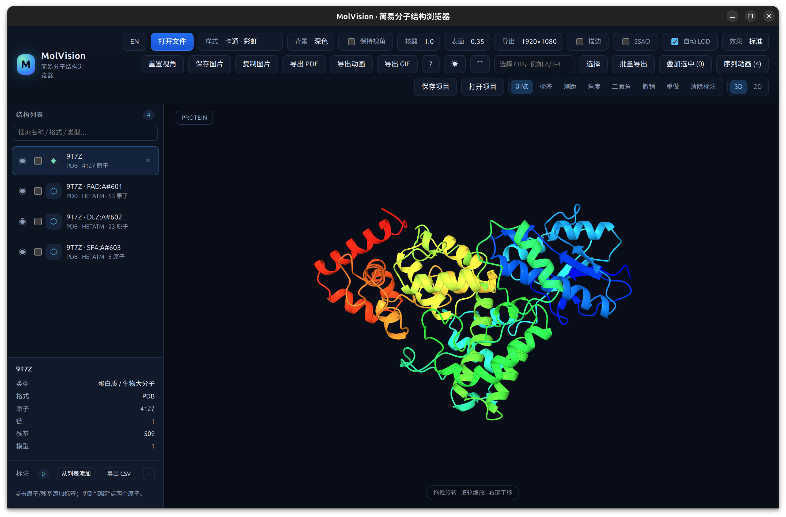

# MolVision



桌面版分子/蛋白结构查看与出图工具。基于 **Electron + COSMol WASM + RDKit WASM**，
完全离线运行。

## 功能

- 导入 **SDF / MOL / PDB / mmCIF / CSV**
- 小分子：球棍 / 棍状 / 球体；蛋白：卡通（彩虹/单色）/ 棍状 / 球体 / 表面 / 卡通+表面（表面透明度可调）/ CA 骨架（快速）
- 核酸（DNA/RNA）：“核酸骨架”（P 球+棒）、“核酸卡通”（骨架样条 + 糖环/碱基环）、“核酸 Ribbon”（平行传输标架 + 椭圆截面扫掠 + 圆角端盖 + 按碱基渐变着色 + 嘌呤/嘧啶宽度微调）；核酸透明度 1.0/0.8/0.6；屏幕空间深度边缘描边 + 轻量 SSAO、“Ribbon + 碱基平面”（平面投影 + 多级圆角斜面挤出 + C1' 连接）
- CSV 导入弹窗：选择分隔符、表头、SMILES 列/名称列，或 element/x/y/z 坐标列；可应用到本次全部 CSV
- 极简 2D 结构式（RDKit WASM）：SVG 矢量导出；3D ↔ 2D 选中双向高亮；可显示原子编号
- 高分辨率导出：1920×1080 / 2560×1440 / 3840×2160 / 2048×2048 / 窗口尺寸
- 导出背景：深色 / 白色 / 透明（PNG alpha）
- 300 DPI PNG 元数据；可勾选“保持视角”
- 标签自动避让、可拖拽；残基标签锚点取 CA
- 批量导出支持进度、取消与绘制帧屏障
- 项目保存/加载（结构 + 相机 + 标注 + 背景/样式）
- `.gz` 压缩结构/CSV 导入；MOL2 / XYZ 导入；XLSX 首个工作表导入；标签双击重命名；测量条目点击定位
- 复制当前视图 PNG 到系统剪贴板（Ctrl/Cmd+Shift+C）
- 导出当前视图为 PDF（PNG 嵌入，无额外依赖）
- 导出 360° 转盘动画 WebM（MediaRecorder，36 帧）
- 结构列表逐项显示/隐藏（隐藏项不参与叠加/批量导出）
- 全屏按钮
- E2E 冒烟：`npm run test:e2e`（SDF/gz/MOL2/XYZ/XLSX、2D、描边、英文 UI 无中文残留）
- 多结构叠加：勾选 2 个以上结构，按颜色区分叠加查看/导出
- 序列动画：同一文件的多记录结构（如多记录 SDF）可播放/停止
- 结构列表搜索；超过 500 条自动截断并提示搜索；Ctrl/Cmd+O 打开、Ctrl/Cmd+S 保存项目
- 中英文界面切换（右上角 EN/中文）
- 文件读取、SDF 拆分与 SDF/MOL2/XYZ 的 Cosmolkit 解析都在 Web Worker 中完成，主线程只重建传输对象
- 窗口大小/位置记忆；单实例运行（重复启动聚焦已有窗口）
- 标注导出 CSV（标签坐标、测量类型/原子/数值）
- PDB/mmCIF HETATM 按残基拆分；信息面板显示分子量
- CSV 编码自动探测（UTF-8/UTF-16/GB18030）
- 3D 标注：
  - 点击原子/残基加标签；也可从原子/残基列表添加
  - 距离 / 角度 / 二面角标注（2/3/4 个原子），可删除
- 标注撤销/重做（按钮 + Ctrl/Cmd+Z）
  - 标注随结构保存，导出图片时自动合成
- 单张 PNG 导出（含标注）；批量导出 ZIP（每结构 PNG + 小分子 2D SVG + manifest.csv）
- 深/浅背景、固定视角、透明底（取决于 WASM 截图 alpha）

## 开发运行

```bash
# 首次
npm install
cd webapp && npm install && cd ..

# 启动 Electron
npm start

# 或只启动渲染层（浏览器调试）
cd webapp && python3 serve.py --no-browser --port 8765
# 打开 http://127.0.0.1:8765/
```

## 打包

```bash
npm run dist -- --linux AppImage     # Linux
npm run dist -- --win portable       # Windows
npm run dist -- --mac dmg            # macOS（需在 macOS 构建）
```

产物在 `release/`。三个平台各产出一个下载文件；macOS 是 `.dmg`，内含 `.app`。

## 目录

```
├── electron/          Electron 主进程 + preload
├── webapp/            渲染层（HTML/JS/CSS）+ WASM 包
│   ├── app.js          UI、场景、CSV 弹窗、导出
│   ├── parsers.js      SDF/PDB/mmCIF/CSV 适配
│   ├── annotations.js  投影、标签、测距、导出合成
│   └── serve.py        浏览器调试服务器
├── COSMol-viewer      参考库（已打补丁）
├── patches/           相机/帧计数补丁与说明
├── scripts/           WASM 构建、打补丁安装脚本
├── vendor/            预编译的 patched COSMol 包
├── build/             应用图标
├── .github/workflows/ 三平台构建 CI
├── tests/             纯函数单元测试（node:test）
├── docs/              方案与待完善清单
└── release/           打包产物
```

## 实现要点

### 相机补丁

COSMol 原始 API 不暴露实时相机，无法把 3D 点投影到屏幕。补丁：

- `crates/core/src/shader/canvas.rs`
  - `CameraSnapshot` + `latest_camera_snapshot()`
  - `Canvas::custom_painting` 每帧写入
- `crates/core/src/lib.rs` 重导出
- `wasm/src/viewer.rs` 新增 `Viewer.cameraState() -> Float32Array`

重新构建 WASM：

```bash
rustup target add wasm32-unknown-unknown
wasm-pack build wasm --target web --release --out-dir pkg --out-name cosmol_viewer_wasm --locked
# 将 pkg/*.wasm/js/d.ts 覆盖到 webapp/node_modules/@cosmol-studio/cosmol-viewer/
```

补丁尽量保持最小，便于上游合并或升级时重放。

### 标注与导出

- 3D 画布上叠透明 `<canvas>`，`pointer-events:none`；标注模式下改为 `auto`，避免
  COSMol 把点击当成拖拽旋转。
- 相机参数（azimuth/elevation/roll/distance/target/fov）来自 `viewer.cameraState()`，
  用与 Rust 端一致的 orbit 四元数/透视投影换算屏幕坐标。
- 显示与导出共用 `AnnotationLayer._drawContent()`；导出时 3D 截图 + 标注按分辨率重绘。
- 批量导出逐条重建场景，等待两帧 + 400 ms 后再截图，避免截到空帧。

### 2D

RDKit MinimalLib 以经典 `<script>` 加载（UMD，非 ESM），`window.initRDKitModule()` 初始化；
`get_mol()` → `get_svg()`。CSP 需要 `unsafe-eval`（RDKit 内部使用），仅本地内容。

## 交付总结

20 批功能与验证记录见 [docs/交付总结.md](docs/交付总结.md)。

## 已知限制

- 2D 仅小分子/配体；蛋白无 2D。
- 核酸无卡通，回退球棍。
- PDB 多模型只显示第一个模型；HETATM 过滤水后单独成“配体/杂原子”条目。
- 超大结构（10 万原子级）的内存与批量导出队列仍需优化。
- 本仓库的 Electron 构建为本地验证版；正式分发前需代码签名/公证。
- `webapp/node_modules` 中的 COSMol WASM 是打过相机补丁的构建，升级需重放补丁。

## 许可

COSMol Viewer / COSMolKit：MIT；RDKit：BSD；Electron：MIT。二次分发请保留相应 LICENSE。

## 已验证

导出前在顶部“导出”下拉选择分辨率；单张与批量导出都生效。

- 浏览器（Chromium/SwiftShader）与 Electron 渲染层：SDF/PDB/mmCIF/CSV、2D、标签、测距、单张/批量导出
- 高分辨率：1920×1080、3840×2160 导出均通过，标注随分辨率缩放
- 白底/透明底与 300 DPI 已验证；透明 PNG 背景 alpha=0
- Linux AppImage：`release/MolVision-0.1.0.AppImage`
- Windows：`release/MolVision-0.1.0-win-x64.zip`（解压后运行 `MolVision.exe`；未签名，SmartScreen 可能提示）（约 134 MB）
  - 本沙箱环境需 `APPIMAGE_EXTRACT_AND_RUN=1`（无 FUSE）
  - 若首次启动被沙箱拦截，可加 `--no-sandbox`
- 相机补丁：`viewer.cameraState()` 返回 azimuth/elevation/distance/target/fov/frame
- 标注导出：PNG 像素中确认包含标签/距离颜色（#ffd166）
- 批量导出：ZIP 内每个结构一张 PNG；小分子另有 2D SVG/PNG；带 manifest.csv
- 项目保存/加载、搜索、PDB/mmCIF 配体拆分、300 DPI、角度/二面角、撤销/重做、CSV 批量映射、2D/3D 双向选中高亮、多结构叠加、序列动画、核酸骨架、CA 骨架（5.8 万原子）均通过浏览器验证
- 单元测试 `npm test`（几何/测距/PNG DPI/CRC）通过
- Mesh 图元（圆角 ribbon / 挤出碱基平面）已通过 1BNA 渲染验证；原有卡通/表面/球棍回归通过
- Worker 导入、中英文切换、核酸卡通已通过浏览器验证
- 加载示例已移除，只保留“打开文件/拖拽”入口
- 批量截图使用 `cameraState()` 的 frame 计数等待绘制帧，不再固定 sleep

## 待办

- Windows portable / macOS dmg 需在对应平台或 CI 构建（配置已就绪）
- 代码签名/公证
- 大批量结构的内存与导出队列优化
